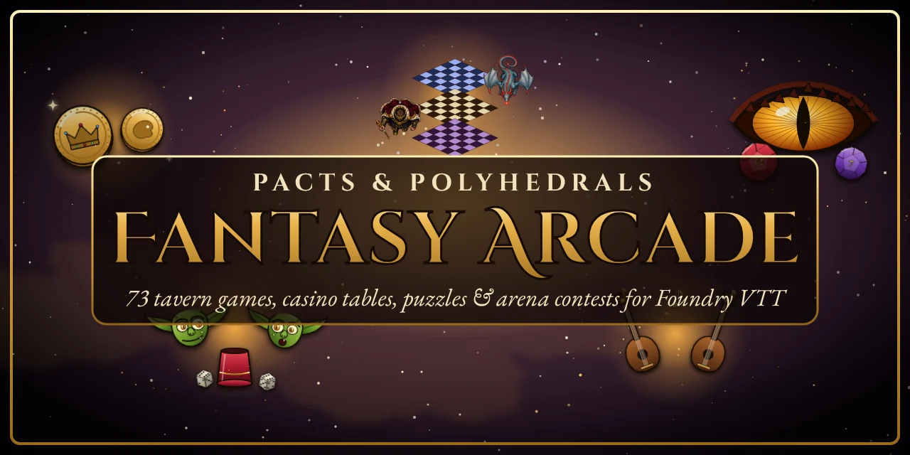

# Pacts & Polyhedrals — Fantasy Arcade



**Release:** `0.5.2-alpha.5.2` (art, rulebook & mechanics audit) • **Target:** Foundry VTT v14 • **System:** agnostic — works in any game system • **By:** Asmo, Pacts & Polyhedrals (Ben Vale)

73 playable minigames for your table — dice and casino games, card and board games, tavern contests, co-operative puzzles, performances and tactical arena bouts — each with **original cover art, a guided lesson and complete written rules**. A further 58 designs are catalogued in `data/catalog.json` as planned work. Everything uses **fictional points only** and never changes character sheets.

## What’s new in 0.5.2

- **Artwork for every game:** 73 hand-built cover illustrations (library thumbnails, game headers and rulebook pages), a module banner, 14 arena kit tokens, and the original **Wyvern Chess piece sprites** by DM Asmo replacing emoji on the three boards.
- **The Fantasy Arcade Rulebook:** a bundled JournalEntry compendium with 85 pages — getting started, GM tools, arena basics, and full rules for all 73 games, organised by category with cross-links. The same rules appear in a collapsible panel on every game page, and a **📖 Rulebook** button opens the journal at the right page.
- **Mechanics audit:** 20+ rules bugs fixed (see `CHANGELOG.md`), from Cauldron Craps never holding its point to co-operative arena allies being able to attack each other. A new audit suite drives every game to completion through the real session authority and fuzzes every single-seat engine with hostile input — **104 automated test groups pass**.
- **Foundry polish:** works on plain-http LAN hosts (no `crypto.randomUUID` dependency), Foundry-native confirmation dialogs, bundled Cinzel / EB Garamond typography (SIL OFL).

## Installation

**Manifest (once the GitHub release is published):** in Foundry’s *Install Module* dialog paste
`https://github.com/pacts-and-polyhedrals/pacts-fantasy-arcade/releases/latest/download/module.json`

**Manual / The Forge custom package:**
1. Back up your world first and test in a development world.
2. Unzip `pacts-fantasy-arcade.zip` into `<Foundry User Data>/Data/modules/pacts-fantasy-arcade/` — the zip has its files at the root, so `module.json` must end up directly inside that folder. (On The Forge, upload the zip as a custom module.)
3. Launch Foundry v14 and enable **Pacts & Polyhedrals | Fantasy Arcade** in *Manage Modules*.
4. Click **🎲 Fantasy Arcade** (lower-left) or run `game.pactsFantasyArcade.open()`.
5. Open the **Fantasy Arcade Rulebook** from the Compendium tab (in the *Pacts & Polyhedrals* folder), or with `game.pactsFantasyArcade.openRules('goblin-s-bluff')`.

**Upgrading from 0.5.1:** replace the module folder. World data (schema 5) is unchanged and carries over.

**Data:** state is stored in the hidden world setting `pacts-fantasy-arcade.arcadeWorldState` (**schema 5**; schemas 2–4 still upgrade). A connected GM is required to referee tables.

## Four priority game-system integrations (Alpha 5.1)

**Imagi-Nations RPG, D&D 5e, Pathfinder 2e and Daggerheart** are the native-priority systems, all recognised automatically from the active Foundry world. In any game lobby, the GM can now preview eligible world Actors, **auto-match assigned User Characters**, approve a specific Actor for each table seat, and optionally connect a Scene/Journal by reference. The source sheets are never altered, and the system does not bulk-copy or automatically expose world data. Unknown systems fall back to an identity-only link.

Imagi-Nations uses its real 10-stat split between Capability and Connection; `learner` Actor records are excluded. D&D uses ability modifiers and proficiencies; Pathfinder uses ability modifiers and proficiency ranks; Daggerheart uses its six traits, spellcasting subclass trait and *advisory* Experience matches. No native spell/feat execution, Hope/Stress spending, emotional inference or automatic item payouts occurs. **Arena roles and capped modifiers** are selected when applicable; three existing physical contests consume a limited sheet assistance bonus. Luck and strategy remain player-led. These are mappings, not full game-system rules emulation.

See [`docs/CHARACTER-IMPORT-SYSTEMS.md`](docs/CHARACTER-IMPORT-SYSTEMS.md) for exact source fields, consent controls, examples and the four-system live acceptance matrix. The test suite now includes 90 passing automated groups, but live Foundry/Forge testing is still outstanding.

## Current games (73)

### Original 20 (Alpha 1)

- **Dice/casino:** Coin of Fate, Wyrm's Eye, Serpent's Seven, Lucky Kobold, King's High Roll, Devil's Knuckles, Three-Dragon Slots, Seven Skulls, Crown & Bones.
- **Tavern/festival:** Arm Wrestling at the Bar, Kattal's Hammer, Darts of the Deep, Sly Fox's Three Cups, Tavern Trivia.
- **Puzzle/crafting:** Tomb of the Restless Grave, Emoji Rune Door, Potion Sorting Sprint.
- **Cards/board:** Black Dragon, Three-Card Wyvern, Runestone Checkers.

### Added 15 (Alpha 2)

| Game | How players interact | Solo or shared |
|---|---|---|
| **Giant's Grip** | Build tension and judge when to bank a haul | Independent contest |
| **Cauldron Craps** | Roll two dice, manage risk through the round | Independent contest |
| **Witches' Triad** | Roll and reserve dice to assemble combinations | Independent contest |
| **Moonlit Solitaire** | Select exposed cards in a pyramid and discard valid pairs | Independent puzzle |
| **Wobblin' Goblin Drinking Contest** | Balance stamina and risk in an imaginary drinking contest | Independent contest |
| **Giant's Skittles** | Choose aim and force to knock down pins | Independent contest |
| **Goblin Tankard Toss** | Choose throwing angle and strength | Independent contest |
| **Barrel Bash** | Hit targets with tactical strike choices | Independent contest |
| **Tinker's Lock Race** | Solve rune tumbler combinations | Independent puzzle |
| **Fizzlenub's Feast** | Select ingredients and heat for an NPC's request | Independent crafting contest |
| **Ispin's Impossible Tale** | Choose story continuations, scoring narrative decisions | Independent performance contest |
| **Goblin Breakdancing Corporation** | Repeat and plan dance sequences | Independent performance contest |
| **Goblin's Bones** | Take turns flipping concealed memory tiles, claim matching pairs | Shared, 2–4 participants |
| **Dwarven Dominoes** | Play a double-six domino chain, draw/pass by the legal rules | Shared, 2–4 participants |
| **Goblin's Bluff** | Secret dice hands, escalating bids, challenges and eliminated dice | Shared, 2–6 participants |

Most independent games can be played in separate seats at a shared table, with scoreboards and NPC contestants. **Runestone Checkers** and the three new games listed as shared use turn-by-turn shared boards. The NPC uses the same action schema as a player; it does not possess full roleplay or strategic intelligence. These are early 2D DOM/CSS experiences, **not finished Foundry map-token sports or combat simulations**.

## Added 8 games and shared systems (Alpha 3)

| Game | How players play | Notable rules and UI |
|---|---|---|
| **Waterdeep Hold’em** | Read two private cards, watch five community cards appear, and check/call/raise/fold across preflop, flop, turn and river | 5-to-7-card ranking, three hands, bounded raises, **fictional points only** |
| **Three Wyrms Ante** | Select elemental cards to contest several tricks | Original game rules; **not** the proprietary Three-Dragon Ante game |
| **Dragon’s Trick** | Lead, follow suit and time trump cards | Shared trick table with rank and scoring |
| **Bard’s Bluff** | Place a face-down card, claim a rank, then accept or challenge | Secret hand projection; exposed results for challenges |
| **King’s Gambit** | Deploy strength cards across three lanes | Alternating turns and lane-majority scoring |
| **Elemental Conquest** | Select and place elemental tiles on a shared 4×4 realm | Orthogonal adjacency bonuses and element majorities |
| **Royal Hunt** | Choose terrain and a risky or cautious approach | Encounters, stamina, turn sequencing, NPC hunts |
| **Wyvern Chess** | Move pieces on Sky, Land and Underworld; click legal destinations across layers | Native adapted three-board chess rules, Basilisk freezing, ranged Dragon captures, check and checkmate, simple AI |

The **🏆 Tournament Hall** allows a GM to set up 2-, 4- or 8-competitor single-elimination brackets from connected players, automatic NPCs or personally controlled NPCs. Each bracket pairing launches a real shared game. Decisive game results advance brackets automatically; the GM may adjudicate drawn matches with an audit record. Tournaments and linked tables survive schema-3 world-state restoration.

For Stage 3 games, a **⏪ public replay control** navigates non-secret historical table positions. Card-game snapshots retain publicly visible cards, scores and events but intentionally do **not** include hidden hands or shuffled decks. Wyvern Chess positions are reconstructed from recorded legal moves. A replay viewer cannot make game moves until returning to **Live**. This is not a cryptographic replay proof.

Each new game has three guided tutorial steps plus a **clickable rules-practice question** with explanatory feedback. Existing lessons demonstrate the action type, but **full practice games and piece-by-piece animated lessons remain future work**. Wyvern Chess includes an early tactical NPC, not the complete original Grukk lesson course or Warlord-mode AI.

### Wyvern Chess rights and attribution

This is a **modified, unofficial, noncommercial Foundry adaptation**, based on the original rules at [Pacts & Polyhedrals / wyvern-chess](https://github.com/pacts-and-polyhedrals/wyvern-chess), created by **DM Asmo / Pacts & Polyhedrals**. The original Wyvern Chess Community License is copied to `licenses/WYVERN-CHESS-LICENSE.md` and its restrictions apply. The standalone site and its artwork are not embedded; the board uses Unicode/emoji symbols. Licensing for commercial distribution needs explicit clearance under the original terms. Full behaviour/AI parity against the browser version is not yet certified.

## Added 16 cooperative puzzles and GM scene workflows (Alpha 4)

This stage adds a playable **Puzzle Forge**, not just another catalogue of riddles. Players move the same mechanism in real time and share progress and clue rewards. The GM can join as an NPC seat, observe or guide the group; players may join a running cooperative puzzle table.

| Puzzle family | Included activity | Player action |
|---|---|---|
| Linked giants lore | Starforge Giant Lore Chain | Solve five connected challenges and unlock original giant-lore clues |
| Riddle and ciphers | Scribe's Riddle Tablet; Ink-Bound Door; Riddle Book Procedural Challenges | Type answers; system checks permitted variants and supplies optional progressive hints |
| Rune and sentence order | Night Serpent Emoji Ritual; Grammar of Grief | Select runes or story fragments in the correct order |
| Audio memory | Bone Choir; Crystal Gate Tone Lock | Watch/listen to an original four-note demonstration, then reproduce the sequence |
| Moon locks | Tri-Moon Lock | Rotate labelled dials to matching phases |
| Logic and offerings | The Three Hungers | Assign distinct items to guardians |
| Branched tests | Weight/Rhythm/Echo Bridge; Three Oaths | Select logical choices, with feedback and penalties for errors |
| Pipe mechanism | The Sluice Sequence | Rotate nine pipes to connect west inlet to east outlet |
| Physical logic | Rotating Gravity Room; Keystone Lattice; Wally-Style Original Trap Builder | Tilt a 5×5 sliding crystal, toggle a 3×3 light puzzle or slide eight plates |

### Puzzle Forge GM Studio

1. Click **🧩 Puzzle Forge** in the GM sidebar to generate a **1–12**-riddle book using a deterministic seed and difficulty setting. These are curated original riddles, not unverified AI-generated text.
2. Select **Edit puzzle pack JSON** or use **GM Pack Studio → New Linked Puzzle Pack** to author or edit 1–24 validated, connected nodes. Answers, alternative phrasings, hints, choices and progression are stored as world content. Impossible/cyclic links are rejected.
3. Start a puzzle from the main library, optionally selecting a custom puzzle pack. The party sees the playable mechanism and unlocked clues, not the GM's unearned solutions.
4. On a scene, select a **Region or Tile** to trigger the game, the puzzle/pack and a target **Tile or door Wall**. A completed puzzle may **reveal/hide a Tile** or **open/close a door Wall**.
5. Use **Launch/resume** from the binding list for a controlled first test. Optionally use the public GM API `await game.pactsFantasyArcade.triggerScenePuzzle("binding-id")` with an appropriate Foundry Region behavior. Automatic GM-host token-entry detection is experimental and requires an online GM.

**No arbitrary scripts can be embedded in a puzzle pack.** The stage only allows a prevalidated declarative scene effect. Test scene bindings on a disposable copy of a world until the real Foundry v14 integration is certified.


## Added 14 tactical arena and performance games (Alpha 5)

**The shared Stage 5 engine is a tactical minigame system, not another set of roll-once skill checks.** Each activity has an interactive **9×7 grid**, 2-action turn economy, abilities, terrain, stamina, focus, scores, GM play and NPC tactics. NPCs score legal moves according to positioning, resource use, damage, defence and the objective, with optional one-ply reply evaluation. The GM can configure NPC kits/dialogue personas, take over an NPC mid-bout, delegate it back to automatic play, pause the action or enter a tournament.

| Activity | New interactive challenge |
|---|---|
| Battle of the Bards | Perform/heckle/rebut, move to the spotlight, choose heroic/comic/heartfelt delivery to match shifting crowd tastes |
| Festival Slam Poetry | Stage placement, verse, refrain, momentum, judges |
| Trial by Debate | Argument, rebuttal, evidence and jury favour |
| Bardic Duet | Cooperate with a partner, harmonise and build combined applause |
| Fighting Pit Tournament | Position, guard, dodge, feint, grapple, strike, counter and arena hazards |
| Wizard Duel | Range, cover, line of sight, Ember, Frost, Thunder, Blink, Aegis and Counterspell |
| Monster Wrestler Championship | Clinch, escape, throw, two successful pins or knockout |
| Shield Wall | Defend a shared gate from staged waves with protective stances and attacks |
| Arrow Storm | Aim, dodge, shoot and protect against incoming volley pressure |
| Gladiator's Gauntlet | Survive a champion and timed hazards |
| The Gloop | Rescue a captive by positioning around dangerous slime |
| Melee Training Dummy | Practice legal strikes, guards, combos and stamina management |
| Arena Beast Rider | Mounted-flavoured charging, vaulting and knockback in turn-based arena rules |
| Shadow Heist | Move through cover, hide, distract patrols and extract before alarm is raised |

New files provide an independent arena reducer, 13 kits, 44 base abilities, three levels of tactical NPC decision-making, eight original NPC dialogue personas, speech and public action log, CSS movement trails, projectile effects, optional reduced motion, bounded combat-profile import protocol, and schema-5 migration. The existing 2-/4-/8-person knockout tournament hall can run supported **1v1 arena contests**; a real full-season career/league and >2 simultaneous arena fighters require further builds. All prizes remain fictional game points; source-system health, inventory, gold and experience are never modified.

**External fighting-pit integration:** There is a *data-only* adapter handshake available to a GM at `game.pactsFantasyArcade.arena`. It can safely import bounded arena profiles at the lobby stage. **No bidirectional adapter to the other fighting-pit module has been implemented**, because its specific code/API was not supplied. Do not assume original monster stat blocks, D&D class spells or that module's downtime rewards are automatically available. See `docs/ARENA-ADAPTER-CONTRACT.md`.

**Detailed development documentation:** `docs/ARENA-RULEBOOK.md` (full shipped rules and 44-ability table), `docs/BUILD-REPORT-ALPHA5.md` (implementation status and limits), `docs/FIGHTING-PIT-TOURNAMENTS-DESIGN.md` (future professional leagues, multi-combatant formats and integration), `docs/TEST-RESULTS-ALPHA5.md` and `docs/RELEASE-CHECKLIST.md`.

**Quality limitations:** The alpha is verified by automated Node tests but not by an actual two-client Foundry or Forge playtest. Animations are CSS-level 2D rather than Foundry canvas character animation. Tactical AI is a legal-move heuristic rather than a full natural-language improvising opponent. This is still a development build, and module sockets cannot guarantee protection against malicious competitors.

## GM Pack Studio

World-level **GM-created content packs** can be assigned when a matching game table is created. Packs are validated and store text/answers/settings as world data:

- **Trivia:** 4–80 questions, each with four options and a correct choice.
- **Story:** 4–80 setups with three branches and the preferred continuation.
- **Rune puzzle:** 4–80 rune sequence prompts, four distinct glyphs and a hint.
- **Three-Dragon Slots:** one configuration with six custom symbols and payout values for triples, pairs and the first-three-symbol sequence.
- **Puzzle Forge books:** 1–24 linked puzzle nodes with validated mechanics, accepted answers and progressive hints. 18 original riddle templates can also generate reproducible selections.

The Pack Studio accepts JSON arrays and includes a sample for each type. **Save a separate pack for each desired theme, then select the pack before creating its table.** By default the module uses its built-in content. Do not use this editor for secrets that must be protected from malicious clients.

## Table controls and results

In a game lobby, the host may invite players, add automatic NPC seats or GM-controlled NPC seats, and start the game. The GM can delegate an NPC to AI or take over personally. Scoreboards and table snapshots are saved by the active GM host and will normally reload from world settings after a restart. Players receive projected game snapshots with opponent hands and unrevealed solutions omitted from normal display. Completed matches are recorded once per session in a world scoreboard.

**Important:** Foundry module sockets broadcast packets and are not an authenticated secret protocol. A malicious user could potentially inspect data or forge a sender ID. This module currently assumes cooperative participants and should **never** be used for real-money, crypto, high-value property or consequential betting. Games only award imaginary points; there is no character wallet or item payout integration.

## Files and developer testing

- `module.json` — Foundry manifest.
- `scripts/main.mjs` — launcher, ApplicationV2 interface and Foundry socket/world-state bridge.
- `scripts/core/` — game data, rules, state transitions, custom packs, user-facing projections and AI moves.
- `scripts/ui/` / `styles/` — HTML renderers and CSS.
- `data/catalog.json` — full 131-concept design register (73 coded, 58 planned) with per-game release/status flags.
- `tests/engine.test.mjs`, `tests/stage2.test.mjs`, `tests/stage3.test.mjs`, `tests/stage3-tournament.test.mjs`, `tests/stage4.test.mjs`, `tests/stage5.test.mjs` — Node tests and simulations, including 60 scripted full matches for each Stage-3 card/strategy game and bracket/replay/migration checks.
- `docs/ROADMAP.md`, `docs/RELEASE-CHECKLIST.md`, `docs/MASTER-BLUEPRINT.md`, `CHANGELOG.md` — development handover.

Rebuild the Rulebook compendium after editing `scripts/core/rules-text.mjs` (needs `npm i @foundryvtt/foundryvtt-cli` in the working folder): `node tools/build-journal.mjs .`
Cover art is generated from the Python sources in `tools/art/` (`covers.py`, `motifs.py`).

With Node.js 22 or later:

```bash
node --test tests/*.test.mjs
```

The suite currently contains 104 test groups (including `tests/audit.test.mjs`) verifying each coded engine, shared games, invalid actions, hidden-data UI projections, HTML escaping, custom packs and world save/restore. The tests **do not replace** actual Foundry/Forge installation, cross-client synchronization, browser visuals or screen-reader QA.

## Next milestone

Next, carry out the live Stage 5 Foundry v14 and Forge acceptance checks in `docs/RELEASE-CHECKLIST.md`. The shared tactical arena engine and 14 new activities are built, but live two-client testing, true Foundry canvas animation, multi-actor team fights, the separate fighting-pit-module integration and advanced career leagues still require development. After the arena foundation is hardened, proceed to Magic Bowl and eventually Sorcerous Circuit.

**Art & IP notice:** All cover art, tokens and the banner were created for this module. The Wyvern Chess rules port and the original Wyvern Chess piece sprites are by DM Asmo / Pacts & Polyhedrals and are included under the Wyvern Chess Community License (`licenses/WYVERN-CHESS-LICENSE.md`). Fonts: Cinzel, Cinzel Decorative and EB Garamond under the SIL Open Font License (`assets/fonts/OFL.txt`). No third-party music or asset packs are included.

© 2026 Asmo, Pacts & Polyhedrals (Ben Vale). All rights reserved. See `LICENSE.txt`.
